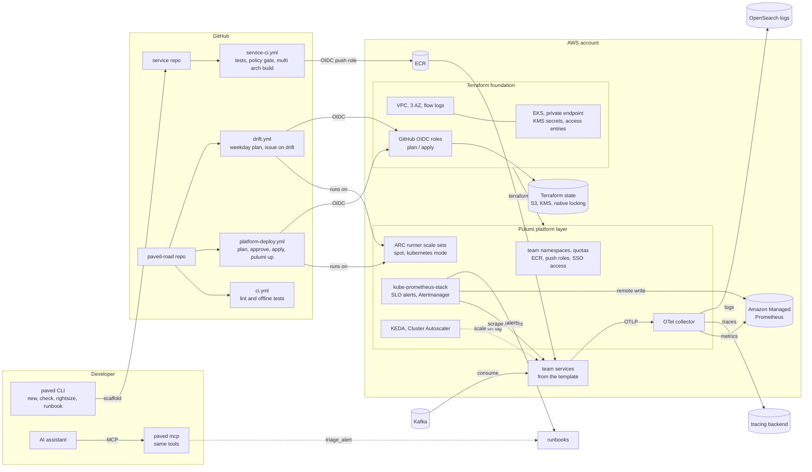

# paved-road

[](https://github.com/pragathigopal7/paved-road/actions/workflows/ci.yml)


An **observable by default** internal developer platform on AWS EKS. A new service starts
from a template that already has structured logs, metrics, traces, health checks, a
NetworkPolicy and a restricted security context, and a policy gate in CI keeps it that way.

It covers the whole path a platform team owns:

* **Infrastructure as code:** Terraform modules for the VPC, EKS and GitHub OIDC roles,
  with remote state and S3 native locking; a Pulumi (Python) layer for in cluster add-ons
  and per team tenancy.
* **CI/CD:** GitHub Actions with GitHub hosted runners for tests and autoscaling self
  hosted runners (Actions Runner Controller on spot nodes) for deploys inside the VPC.
* **Observability:** OpenTelemetry collector, Prometheus with SLO burn rate alerts, Amazon
  Managed Prometheus, and runbooks linked from every alert.
* **Developer tooling:** a Python CLI (`paved`) to scaffold services, check manifests,
  right size workloads and pull up runbooks, plus an **MCP server** so AI assistants can
  use the same tools.

```text
paved new ──► service repo ──► GitHub Actions ──► ECR ──► EKS
   │             │  tests, paved check (PR annotations),       │
   │             │  multi arch build, OIDC push                │
   │             ▼                                             ▼
   └── generated already compliant          OTel ► AMP / traces / logs, alerts ► runbooks
```

## Architecture



## Quickstart

```bash
pip install -e ".[dev]"

paved new refunds-consumer --team payments --topic refunds
cd refunds-consumer
pip install -r requirements-dev.txt && pytest     # 10 tests, no broker needed
paved check deploy/k8s                           # PASS: 0 errors, 0 warnings
```

`make test` runs everything CI runs (Python, Pulumi, Terraform, promtool).
`make local-up` starts Kafka (Redpanda), the example consumer, a producer, an OTel
collector, Jaeger and Prometheus with the platform alert rules.

## The `paved` CLI

### `paved new`: a service that is compliant on day one

Generates a Kafka consumer from [`src/paved/templates/kafka-consumer`](src/paved/templates/kafka-consumer).
The generated output is committed as [`examples/orders-consumer`](examples/orders-consumer),
and a test fails if the two ever drift.

| Concern | What the template gives you |
| --- | --- |
| Delivery | At least once: offsets commit after a message is handled or dead lettered |
| Failures | Bounded retries with backoff, then a dead letter topic with reason headers |
| Logs | JSON with `trace_id` and `span_id` of the active span |
| Metrics | `messages_processed_total`, `message_processing_seconds`, `kafka_consumer_lag`, `dead_letter_messages_total` |
| Traces | One consumer span per message, continuing the producer's W3C trace context |
| Health | `/healthz` fails if the poll loop stalls; `/readyz` passes once the pod joins the group |
| Security | Non root, read only root filesystem, all capabilities dropped, seccomp, NetworkPolicy, own ServiceAccount |
| Scaling | KEDA on consumer lag, PodDisruptionBudget, zone spread |
| CI | Ten line workflow calling the platform's reusable pipeline |

### `paved check`: the policy gate

17 rules across security, reliability and observability. Output formats: text, JSON,
GitHub annotations (inline on the PR) and SARIF (code scanning).

```console
$ paved check tests/fixtures/bad-deployment.yaml
tests/fixtures/bad-deployment.yaml:2  ERROR   PR001 run-as-non-root  Deployment/payments/legacy-worker
    container 'worker' does not set runAsNonRoot: true
tests/fixtures/bad-deployment.yaml:2  ERROR   PR005 no-privileged-or-host-namespaces  Deployment/payments/legacy-worker
    pod spec sets hostNetwork: true
...
FAIL: 2 workloads, 21 errors, 9 warnings, 0 waived

$ paved check examples/orders-consumer/deploy
PASS: 1 workloads, 0 errors, 0 warnings, 0 waived
```

| Area | Rules |
| --- | --- |
| Security | non root, read only root FS, no privilege escalation, drop ALL capabilities, no privileged or host namespaces, seccomp, pinned images, NetworkPolicy selects the pods, no automounted SA token, dedicated ServiceAccount |
| Reliability and cost | CPU and memory requests plus a memory limit (CPU limits optional on purpose), readiness and liveness probes, PDB when replicas > 1 |
| Observability | scraped by a ServiceMonitor or PodMonitor (followed through the Service selector), OTLP endpoint and service name set, JSON logs, `team` and `app.kubernetes.io/name` labels |

Exceptions are explicit: `paved.dev/waive: "PR012"` plus a required
`paved.dev/waive-reason`. A waiver without a reason is itself an error. `paved policy list`
prints every rule with its rationale.

### `paved rightsize`: requests from real usage, with the bill

Reads usage from a JSON export or straight from Prometheus (cAdvisor and
kube-state-metrics), recommends requests from p95 CPU and peak memory, and flags
throttling and OOM risk.

```console
$ paved rightsize --usage examples/usage.json
WORKLOAD                                     CPU REQ       MEM REQ          $/MONTH     DELTA  FLAGS
payments/orders-consumer:app              1000m>230m     2Gi>368Mi     144.16>31.85   -112.31  over-provisioned
payments/ledger-api:app                    250m>480m   512Mi>576Mi      54.06>96.06    +42.00  oom-risk, cpu-throttling, under-requested
search/indexer:app                       2000m>2030m       8Gi>6Gi    255.18>238.37    -16.81
platform/otel-collector:otel-collector     500m>270m     1Gi>464Mi      54.06>28.35    -25.71  over-provisioned
TOTAL                                                                                 -112.83
```

Not every recommendation saves money: `ledger-api` costs more because it is being throttled
and is close to its memory limit. The tool says so instead of only chasing savings.

### `paved runbook`: failure triage playbooks

Eight runbooks in [`src/paved/runbooks`](src/paved/runbooks), each tied to the alerts it
handles. `triage` fills the alert's labels into the commands:

```console
$ paved runbook triage KafkaConsumerLagHigh --label namespace=payments --label consumergroup=orders-consumer
# Kafka consumer lag is growing or the consumer stalled
...
kubectl -n payments exec deploy/orders-consumer -- ...
```

A test keeps alerts and runbooks in sync in both directions: every alert's `runbook_url`
resolves to a runbook that claims it, and every alert a runbook claims exists.

### `paved mcp`: the same tools for AI assistants

An MCP server (stdio) exposing `check_manifests`, `explain_rule`, `scaffold_service`,
`rightsize_workloads`, `search_runbooks` and `triage_alert`.

```bash
pip install -e ".[mcp]"
claude mcp add paved -- paved mcp --workspace .     # Claude Code
```

Guardrails: every path is resolved inside the workspace root and anything outside is
rejected; read only tools carry `readOnlyHint` so clients can auto approve them;
`scaffold_service` is a dry run unless asked otherwise and never overwrites; unexpected
exceptions are logged server side and never echoed to the model.

## Infrastructure

Two layers with a clean hand off: Terraform owns things that are slow to change and
expensive to get wrong (network, cluster, IAM trust); Pulumi in Python owns the in cluster
platform, where loops, typed config and unit tests pay off. Pulumi reads the Terraform
outputs (`terraform output -json`).

### Terraform foundation ([`infra/terraform`](infra/terraform))

| Module | Highlights |
| --- | --- |
| `bootstrap` | State bucket: versioned, KMS encrypted, TLS only, public access blocked. S3 native lock files (`use_lockfile`), no DynamoDB table. |
| `network` | 3 AZ VPC, /19 private subnets sized for VPC CNI pod IPs, NAT per AZ (or one for dev), S3 gateway endpoint to keep image pulls off NAT, flow logs. |
| `eks` | Private API endpoint, KMS envelope encryption for Secrets, all control plane logs, access entries (no aws-auth ConfigMap), IMDSv2 with hop limit 1, encrypted gp3 roots, managed add-ons with VPC CNI NetworkPolicy enforcement and prefix delegation, Pod Identity for EBS CSI, extended support opted out. |
| `github-oidc` | Roles GitHub Actions assume without stored keys. Plan role: pull requests and main, read only, can take the state lock but not write state. Apply role: only the GitHub environment with required reviewers. |
| `platform` | Composes the modules per environment from `env/<env>.tfvars` and `env/<env>.backend.hcl`. Graviton general pool, spot x86 CI pool tainted for runners. |

Every module has offline `terraform test` suites with mocked providers that assert the
properties above, for example "pods cannot reach instance credentials", "the plan role
cannot overwrite state" and "the API endpoint cannot be opened to 0.0.0.0/0".

### Pulumi platform layer ([`infra/pulumi`](infra/pulumi))

Team onboarding is a pull request to [`teams.yaml`](infra/pulumi/teams.yaml). Each team gets:

* a namespace enforcing the **restricted** Pod Security Standard, a ResourceQuota (no
  LoadBalancer Services), container defaults, and default deny ingress;
* ECR repositories per service: immutable tags, scan on push, KMS, lifecycle rules;
* a CI push role trusted only for the team's repositories on `main`;
* `kubectl` access for the team's SSO role, scoped to its namespace (EKS access entries);
* an autoscaling GitHub Actions runner scale set (`runs-on: paved-<team>`).

Cluster add-ons: kube-prometheus-stack writing to Amazon Managed Prometheus, the
OpenTelemetry collector, KEDA, Cluster Autoscaler (IAM limited to this cluster's node
groups) and Actions Runner Controller. Runners use ARC's **kubernetes mode**, so CI jobs
never need privileged Docker in Docker. Every AWS permission for in cluster workloads goes
through EKS Pod Identity. Charts are pinned in one file.

The program is unit tested against Pulumi's mock engine, asserting on the exact inputs
sent to AWS and Kubernetes.

## CI/CD

| Workflow | What it does |
| --- | --- |
| [`ci.yml`](.github/workflows/ci.yml) | Ruff and pytest; Terraform fmt, validate, test and tflint; Pulumi unit tests; promtool rule checks and alert unit tests; the example service through the reusable pipeline. |
| [`service-ci.yml`](.github/workflows/service-ci.yml) | Reusable pipeline every service calls: tests, `paved check` as PR annotations and SARIF, amd64 and arm64 image build, OIDC push to ECR on main with provenance and SBOM. |
| [`platform-deploy.yml`](.github/workflows/platform-deploy.yml) | Plan, then apply exactly the reviewed plan behind a GitHub environment, then `pulumi up`. Runs on a self hosted scale set inside the VPC because the EKS endpoint is private. Applies are serialized per environment and never cancelled midway. |
| [`drift.yml`](.github/workflows/drift.yml) | Weekday `plan -detailed-exitcode` per environment; opens or updates an issue on drift. |

Deploy and drift jobs are skipped until the AWS role variables are set, so the repository
stays green without an AWS account.

## Observability

* **Contract:** services emit OTLP to `otel-collector.observability:4318` and expose
  `/metrics`. The collector adds Kubernetes metadata and fans out to Amazon Managed
  Prometheus, a tracing backend and OpenSearch; services never know which vendor is behind it.
* **SLOs:** 99.9% of messages handled without dead lettering, with multi window burn rate
  alerts (14.4x over 1h and 5m pages, 6x over 6h and 30m opens a ticket) built on
  recording rules.
* **Alerts:** consumer lag (only when it is also growing), stalled consumers, DLQ growth,
  crash loops, NotReady nodes, queued CI jobs, and the collector dropping data, each with
  a runbook. `promtool` unit tests prove they fire on realistic series and stay quiet on
  healthy ones (for example, high but stable lag does not page).

## What is verified

| Suite | Count | Runs offline |
| --- | --- | --- |
| Python: policy engine, scaffolder, generated service, right sizing, runbooks, MCP, CLI | 71 tests | yes |
| Pulumi program (mock engine) | 16 tests | yes |
| Terraform `terraform test` with mocked providers | 17 runs | yes |
| promtool alert unit tests | 5 scenarios | yes |

The infrastructure code validates against the real AWS provider schema and is unit tested
with mocked providers; applying it needs an AWS account and the bootstrap steps in
[`infra/terraform/README.md`](infra/terraform/README.md).

## Layout

```text
src/paved/              CLI, policy engine, scaffolder, right sizing, runbooks, MCP server
  templates/            kafka-consumer service template
  runbooks/             failure triage playbooks (linked from alerts)
examples/               generated orders-consumer service, sample usage export
infra/terraform/        bootstrap, modules (network, eks, github-oidc), platform root
infra/pulumi/           platform layer: add-ons, team tenancy, runner scale sets
platform/               Helm values and Prometheus rules shared by Pulumi and local dev
local/                  docker compose stack mirroring the cluster
.github/workflows/      ci, reusable service pipeline, deploy, drift
docs/                   design decisions
```

Design trade offs (why Terraform and Pulumi, why no CPU limits, why ARC kubernetes mode,
why Pod Identity, and what I would add next) are in
[`docs/design-decisions.md`](docs/design-decisions.md).
